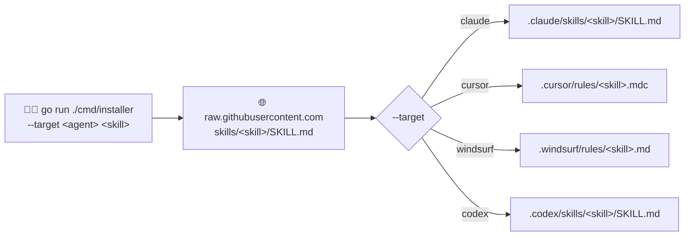
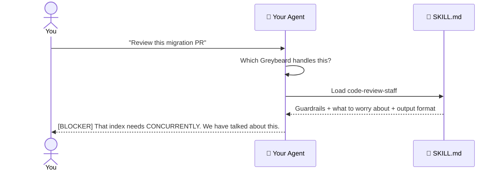
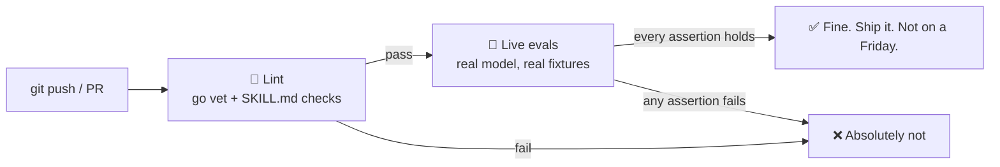
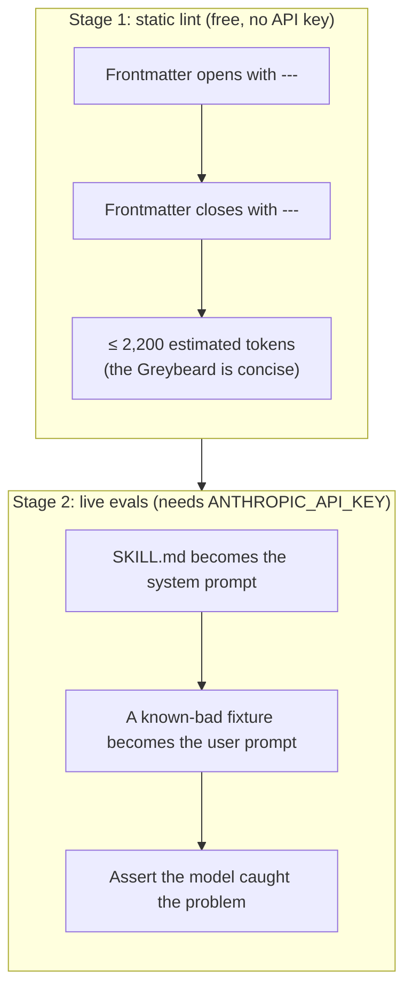

<div align="center">

# 🧙 greybeard

### *Your agent, with 20 years of 3 a.m. pages.*

**Eval-tested AI agent skills for Staff Engineers, SREs, and anyone who has ever been paged.**

[](https://github.com/drarnold/platform-engineering-skills/actions/workflows/evals.yml)


[](LICENSE)

Works with **Claude Code** · **Cursor** · **Windsurf** · **OpenAI Codex CLI**

[Meet the Greybeard](#-why-this-exists) · [Install](#-install-it) · [How It Works](#-how-it-works) · [The Skills](#-the-skills) · [The Laws](#-greybeards-laws) · [Eval Pipeline](#-trust-but-verify) · [Teach It Something](#-teach-the-greybeard-something-new)

</div>

---

## 🍵 Why This Exists

Every team has one. The engineer who looks at your PR, sighs, and says *"have you tried `CONCURRENTLY`?"* They've been paged for things you haven't invented yet. Their instincts are worth more than any linter.

Then they retire. Or go on vacation. Or it's 3 a.m. and they're asleep, as is their right.

Your AI agent doesn't have those scars. Left alone, it will:

| What the junior agent does | What the Greybeard does instead |
|---|---|
| 🎯 Writes clever code and ignores the **blast radius** | Asks what falls over when this breaks, and in what order |
| ⚡ Runs the destructive command first, **asks questions never** | Gathers evidence before touching anything |
| 🌊 **Drifts quietly** until a prompt tweak breaks an edge case | Gets regression-tested in CI like the infrastructure it is |

So this repo puts the Greybeard in a box. Each skill is a focused `SKILL.md` carrying hard-won opinions, with explicit guardrails and predictable output. A small Go CLI installs them, and a CI pipeline makes sure they still work.

> *"It worked in staging."*
> *(the Greybeard sighs)*

---

## 📦 Install It

```bash
# Summon the whole Greybeard into Claude Code  →  .claude/skills/
go run ./cmd/installer --target claude --all

# Or one skill at a time, into Cursor           →  .cursor/rules/
go run ./cmd/installer --target cursor incident-triage
```

Run it from the root of the project you want to protect.

### Where each agent keeps its Greybeard

| `--target` | Installs to | Format |
|---|---|---|
| `claude` | `.claude/skills/<skill>/SKILL.md` | folder + `SKILL.md` |
| `cursor` | `.cursor/rules/<skill>.mdc` | single `.mdc` file |
| `windsurf` | `.windsurf/rules/<skill>.md` | single `.md` file |
| `codex` | `.codex/skills/<skill>/SKILL.md` | folder + `SKILL.md` |

---

## ⚙️ How It Works

### 1. The Summoning: one `SKILL.md`, four agents



### 2. The Consultation: your agent asks the old-timer

Each skill advertises a one-line `description`. The agent matches your request to the right Greybeard, loads it, and follows its rules.



### 3. The Skepticism: nothing ships on vibes



---

## 🧰 The Skills

| Skill | The nickname | Call on it when… | The Greybeard cares about |
|---|---|---|---|
| 🚨 [`incident-triage`](skills/incident-triage/SKILL.md) | **The Pager Whisperer** | Something is on fire, or it's post-mortem time | Stopping the bleeding first. Contain blast radius, get evidence, *then* mutate state |
| 🏛️ [`architecture-rfc`](skills/architecture-rfc/SKILL.md) | **"It Depends™"** | Drafting or reviewing a design doc or ADR | Trade-offs, failure modes, tail latency, and what this costs next quarter |
| 🔒 [`ci-cd-hardening`](skills/ci-cd-hardening/SKILL.md) | **Pin Your Actions, Fool** | Auditing Dockerfiles, GitHub Actions, pipelines | Supply chain, script injection, unpinned actions, slow builds |
| 📈 [`observability-slos`](skills/observability-slos/SKILL.md) | **Alert on Symptoms, Not Vibes** | Designing telemetry and alerts | OpenTelemetry, Prometheus rules, multi-window burn-rate SLOs. Nobody wants to be paged for CPU |
| 🔍 [`code-review-staff`](skills/code-review-staff/SKILL.md) | **Have You Tried `CONCURRENTLY`?** | Reviewing a diff, schema change, or PR | Zero-downtime migrations, concurrency hazards, API compatibility. Zero nitpicks |

---

## 📜 Greybeard's Laws

Not enforced by the code, but you'll feel them in every skill.

1. **Never deploy on a Friday.** Not even a tiny change. *Especially* the tiny change.
2. **It's always DNS.** If it isn't DNS, it's certificates. If it isn't certificates, it's DNS.
3. **If it isn't monitored, it isn't production.** It's a hobby with a load balancer.
4. **A backup you haven't restored from is a hope, not a backup.**
5. **Restore service first. Find the root cause second.** Nobody gets a medal for the elegant RCA while the site is down.
6. **Alert on what users feel, not what servers whine about.**
7. **"Temporary" workarounds are load-bearing.** Give them an owner and a delete date.
8. **Every retry without backoff is a future outage.**
9. **Pin your dependencies.** The internet is not your friend.
10. **Read the runbook. Then read the other runbook.**

---

## 🧪 Trust, But Verify

The Greybeard has been wrong before, which is how they got to be the Greybeard. So the skills get tested. The harness in [`cmd/evals`](cmd/evals/main.go) runs in two stages.



### The trap, and what the model has to catch

| Skill | The trap | It must… |
|---|---|---|
| `code-review-staff` | [`bad_migration.sql`](evals/fixtures/bad_migration.sql) | flag it `[BLOCKER]`, demand `CONCURRENTLY` on the index, and spot the lock/default risk |
| `ci-cd-hardening` | [`insecure_workflow.yml`](evals/fixtures/insecure_workflow.yml) | flag it `[CRITICAL]`, catch the script injection, and demand SHA-pinned actions |

> **Honest status:** all 5 skills pass lint. Live evals cover `code-review-staff` and `ci-cd-hardening`. The other three are on the list, and the Greybeard has opinions about untested code, so expect more.

### Run it yourself

```bash
# Lint only: fast, free, no key
go run ./cmd/evals --lint-only

# The full interrogation: lint + live model evals
ANTHROPIC_API_KEY=sk-ant-... go run ./cmd/evals
```

In GitHub Actions, lint gates the live evals. Live evals skip on fork PRs, because secrets don't go to strangers (see Law 9).

---

## 🎓 Teach the Greybeard Something New

Got scars of your own? Add a skill:

1. Create `skills/<name>/SKILL.md` with frontmatter:
   ```markdown
   ---
   name: my-skill
   description: One sentence on what it does and when to use it.
   ---
   ```
2. Keep it under **2,200 estimated tokens**. Wisdom should be concise. Lint enforces this.
3. Add the name to `allSkills` in [`cmd/installer/main.go`](cmd/installer/main.go).
4. Prove it works: add a bad fixture in `evals/fixtures/` and an eval in [`cmd/evals/main.go`](cmd/evals/main.go) that the skill has to pass.
5. Run `go run ./cmd/evals --lint-only`, then open a PR.

---

## 📁 Where Everything Lives

```text
.
├── skills/                 # One folder per skill, each with a SKILL.md
├── cmd/
│   ├── installer/          # Summons skills into Claude / Cursor / Windsurf / Codex
│   └── evals/              # Lint + live LLM eval harness
├── evals/fixtures/         # Deliberately terrible inputs for the model to catch
└── .github/workflows/      # CI: lint → live evals
```

---

<div align="center">

*Built for people who get paged. Released under the [LICENSE](LICENSE).*

**Certified by someone who has been paged.** 📟

</div>
