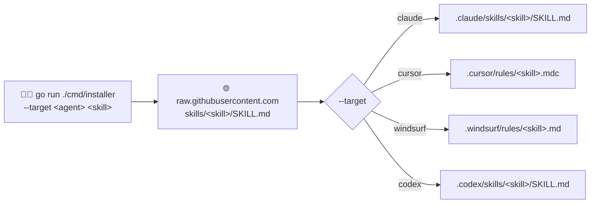
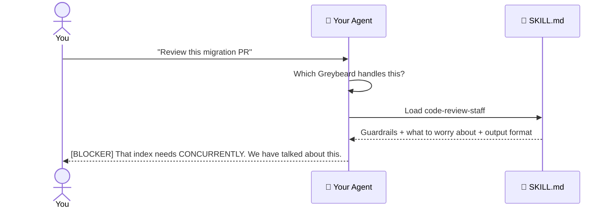
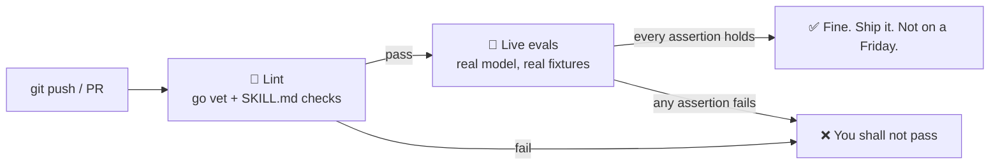
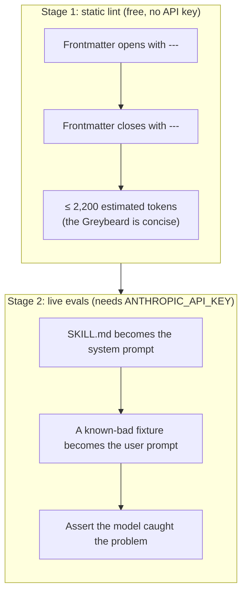

<div align="center">

# 🧙 greybeard

### *Your agent, with 20 years of 3 a.m. pages.*
### *Fly, you fools... to a staging environment first.*

**AI agent skills for the whole software lifecycle, from the vague ticket to the 3 a.m. page. Built for Staff Engineers, SREs, and anyone who has ever shipped.**

[](https://github.com/drarnold/greybeard/actions/workflows/evals.yml)


[](LICENSE)

Works with **Claude Code** · **Codex** · **Gemini CLI** · **GitHub Copilot** · **OpenCode** · **Cursor** · **Windsurf** · **Kiro** · **Command Code**

[Meet the Greybeard](#-why-this-exists) · [Install](#-install-it) · [How It Works](#-how-it-works) · [The Skills](#-the-skills) · [The Laws](#-greybeards-laws) · [Eval Pipeline](#-trust-but-verify) · [Teach It Something](#-teach-the-greybeard-something-new)

</div>

---

## 🍵 Why This Exists

Every team has one. The engineer who looks at your PR, sighs, and says *"have you tried `CONCURRENTLY`?"* They've been paged for things you haven't invented yet. Their instincts are worth more than any linter.

Then they retire. Or go on vacation. Or it's 3 a.m. and they're asleep, as is their right.

Think of Gandalf: never late, nor early, he arrives precisely when the cluster means to fall over. The difference is that Gandalf shows up in person. This one lives in a `SKILL.md`, which is cheaper than a wizard and doesn't need pipe-weed.

Your AI agent doesn't have those scars. Left alone, it will:

| What the junior agent does | What the Greybeard does instead |
|---|---|
| 🎯 Writes clever code and ignores the **blast radius** | Asks what falls over when this breaks, and in what order |
| ⚡ Runs the destructive command first, **asks questions never** | Gathers evidence before touching anything |
| 🌊 **Drifts quietly** until a prompt tweak breaks an edge case | Gets regression-tested in CI like the infrastructure it is |

So this repo puts the Greybeard in a box. Each skill is a focused `SKILL.md` carrying hard-won opinions, with explicit guardrails and predictable output. A small Go CLI installs them, and a CI pipeline makes sure they still work.

> *"It worked in staging."*
> *(the Greybeard sighs)*

> *"You shall not pass... without a rollback plan."*
> *(the Greybeard, planting a staff in the middle of your deploy pipeline)*

---

## 📦 Install It

### The fastest path: any agent, one command

Every skill is a plain `SKILL.md`, so the open [skills CLI](https://github.com/vercel-labs/skills) can install them into most agents:

```bash
npx skills add drarnold/greybeard                          # all 30 skills
npx skills add drarnold/greybeard --list                   # browse first
npx skills add drarnold/greybeard --skill code-review-staff
```

### Or use this repo's own installer

```bash
# Summon the whole Greybeard into Claude Code  →  .claude/skills/
go run ./cmd/installer --target claude --all

# Or one skill at a time, into Gemini CLI       →  .gemini/skills/
go run ./cmd/installer --target gemini incident-triage
```

Run it from the root of the project you want to protect. Speak friend, and `go run`.

### Or go native

<details>
<summary><b>Claude Code</b></summary>

```
/plugin marketplace add drarnold/greybeard
/plugin install greybeard@greybeard
```

For local development: `claude --plugin-dir /path/to/greybeard`.

</details>

<details>
<summary><b>Codex</b></summary>

```bash
codex plugin marketplace add drarnold/greybeard
codex plugin add greybeard@greybeard
```

Codex reads the root `skills/` directory through `.codex-plugin/plugin.json`.

</details>

<details>
<summary><b>Gemini CLI</b></summary>

```bash
gemini skills install https://github.com/drarnold/greybeard.git --path skills
```

Or from a local clone: `gemini skills install ./greybeard/skills/`. Verify with `/skills list`.

</details>

<details>
<summary><b>GitHub Copilot</b></summary>

Copilot discovers skills in `.github/skills/`, `.claude/skills/`, or `.agents/skills/`:

```bash
go run ./cmd/installer --target copilot --all
```

</details>

<details>
<summary><b>OpenCode</b></summary>

```bash
go run ./cmd/installer --target opencode --all
```

OpenCode loads `.opencode/skills/` through its `skill` tool. The [`AGENTS.md`](AGENTS.md) skill-routing table maps intents to skills.

</details>

<details>
<summary><b>Cursor, Windsurf, Kiro, Command Code, and the rest</b></summary>

```bash
go run ./cmd/installer --target cursor --all        # .cursor/rules/*.mdc
go run ./cmd/installer --target windsurf --all      # .windsurf/rules/*.md
go run ./cmd/installer --target kiro --all          # .kiro/skills/
go run ./cmd/installer --target commandcode --all   # .commandcode/skills/
go run ./cmd/installer --target agents --all        # .agents/skills/ (cross-agent convention)
```

Any other agent that accepts instruction files can take a `SKILL.md` pasted into its rules.

</details>

*(The installer takes no rings of power, and nobody has to carry anything to Mordor. Most of it is `curl`.)*

### Where each agent keeps its Greybeard

| `--target` | Installs to | Format |
|---|---|---|
| `claude` | `.claude/skills/<skill>/SKILL.md` | folder + `SKILL.md` |
| `codex` | `.codex/skills/<skill>/SKILL.md` | folder + `SKILL.md` |
| `gemini` | `.gemini/skills/<skill>/SKILL.md` | folder + `SKILL.md` |
| `copilot` | `.github/skills/<skill>/SKILL.md` | folder + `SKILL.md` |
| `opencode` | `.opencode/skills/<skill>/SKILL.md` | folder + `SKILL.md` |
| `kiro` | `.kiro/skills/<skill>/SKILL.md` | folder + `SKILL.md` |
| `commandcode` | `.commandcode/skills/<skill>/SKILL.md` | folder + `SKILL.md` |
| `agents` | `.agents/skills/<skill>/SKILL.md` | folder + `SKILL.md` |
| `cursor` | `.cursor/rules/<skill>.mdc` | single `.mdc` file |
| `windsurf` | `.windsurf/rules/<skill>.md` | single `.md` file |

---

## ⚙️ How It Works

### 1. The Summoning: one `SKILL.md`, every agent



### 2. The Consultation: your agent asks the old-timer

Each skill advertises a one-line `description`. The agent matches your request to the right Greybeard, loads it, and follows its rules.



### 3. The Skepticism: nothing ships on vibes



---

## 🧰 The Skills

Thirty skills, one per stage of the lifecycle. Scrum, Kanban, trunk-based, waterfall-with-extra-steps: the Greybeard has seen every style and has opinions about all of them. The original five ops skills come first, then the rest of the road to Mordor, grouped by stage.

### 🔥 Ops and platform: the original five

| Skill | The nickname | Call on it when… | The Greybeard cares about |
|---|---|---|---|
| 🚨 [`incident-triage`](skills/incident-triage/SKILL.md) | **The Pager Whisperer** (a.k.a. *Balrog Wrangler*) | Something is on fire, or it's post-mortem time | Stopping the bleeding first. Contain blast radius, get evidence, *then* mutate state |
| 🏛️ [`architecture-rfc`](skills/architecture-rfc/SKILL.md) | **"It Depends™"** | Drafting or reviewing a design doc or ADR | Trade-offs, failure modes, tail latency, and what this costs next quarter |
| 🔒 [`ci-cd-hardening`](skills/ci-cd-hardening/SKILL.md) | **Pin Your Actions, Fool** (*Fly, you fools!*) | Auditing Dockerfiles, GitHub Actions, pipelines | Supply chain, script injection, unpinned actions, slow builds |
| 📈 [`observability-slos`](skills/observability-slos/SKILL.md) | **Alert on Symptoms, Not Vibes** | Designing telemetry and alerts | OpenTelemetry, Prometheus rules, multi-window burn-rate SLOs. Nobody wants to be paged for CPU |
| 🔍 [`code-review-staff`](skills/code-review-staff/SKILL.md) | **Have You Tried `CONCURRENTLY`?** | Reviewing a diff, schema change, or PR | Zero-downtime migrations, concurrency hazards, API compatibility. Zero nitpicks |

### 🗺️ Discover and plan

| Skill | Call on it when… |
|---|---|
| [`requirements-grilling`](skills/requirements-grilling/SKILL.md) | A ticket says "make it faster" and nothing else |
| [`story-slicing`](skills/story-slicing/SKILL.md) | The epic is bigger than a sprint, or split by technical layer |
| [`estimation-sanity`](skills/estimation-sanity/SKILL.md) | Someone wants one number. They get a range |
| [`spike-and-prototype`](skills/spike-and-prototype/SKILL.md) | A technical unknown needs answering, and the answer is not "ship the prototype" |

### 🔨 Build

| Skill | Call on it when… |
|---|---|
| [`tdd-red-green`](skills/tdd-red-green/SKILL.md) | Building or fixing test-first, in small red-green-refactor cycles |
| [`refactor-safely`](skills/refactor-safely/SKILL.md) | Restructuring code without changing what it does |
| [`legacy-code-archaeology`](skills/legacy-code-archaeology/SKILL.md) | Nobody dares touch it, and it pays the bills |
| [`api-design`](skills/api-design/SKILL.md) | A new endpoint, or a contract you cannot take back |
| [`error-handling`](skills/error-handling/SKILL.md) | Swallowed exceptions, blind retries, missing timeouts |
| [`comment-cleanup`](skills/comment-cleanup/SKILL.md) | The agent narrated every loop. Prune comments that restate the code and keep the ones that say why |

### ✅ Verify

| Skill | Call on it when… |
|---|---|
| [`test-strategy`](skills/test-strategy/SKILL.md) | Deciding what to test, or fixing a suite nobody trusts |
| [`security-review`](skills/security-review/SKILL.md) | Code touches user input, auth, data access, or secrets |
| [`performance-profiling`](skills/performance-profiling/SKILL.md) | Something is slow and someone proposes an optimization with no data |

### 🚢 Ship and run

| Skill | Call on it when… |
|---|---|
| [`release-and-rollback`](skills/release-and-rollback/SKILL.md) | Planning a rollout with flags, canaries, and a rollback that has been tested |
| [`dependency-hygiene`](skills/dependency-hygiene/SKILL.md) | Adding a library, handling a CVE, or planning upgrades |
| [`tech-debt-triage`](skills/tech-debt-triage/SKILL.md) | The backlog is full of "we should clean that up" |
| [`postmortem-writer`](skills/postmortem-writer/SKILL.md) | The fire is out. Time to learn something without blaming anyone |

### 🧭 Process and style

| Skill | Call on it when… |
|---|---|
| [`trunk-based-development`](skills/trunk-based-development/SKILL.md) | Branches live for weeks and merges hurt |
| [`scrum-ceremonies-sanity`](skills/scrum-ceremonies-sanity/SKILL.md) | The standup is a status report and the retro changes nothing |
| [`kanban-flow`](skills/kanban-flow/SKILL.md) | Work stalls in review and cycle time is a mystery |
| [`monorepo-vs-polyrepo`](skills/monorepo-vs-polyrepo/SKILL.md) | Choosing, splitting, or merging repos |
| [`agentic-coding-hygiene`](skills/agentic-coding-hygiene/SKILL.md) | Reviewing agent-written diffs and deciding how much autonomy to grant |

### 🤝 People and knowledge

| Skill | Call on it when… |
|---|---|
| [`pr-description-writer`](skills/pr-description-writer/SKILL.md) | Opening a PR that should not need a follow-up question |
| [`onboarding-docs`](skills/onboarding-docs/SKILL.md) | A new hire arrives and the README lies |
| [`adr-keeper`](skills/adr-keeper/SKILL.md) | A decision that will be questioned in a year needs a paper trail |

---

## 📜 Greybeard's Laws

Not enforced by the code, but you'll feel them in every skill.

1. **Never deploy on a Friday.** Not even a tiny change. *Especially* the tiny change.
2. **It's always DNS.** If it isn't DNS, it's certificates. If it isn't certificates, it's DNS.
3. **If it isn't monitored, it isn't production.** It's a hobby with a load balancer.
4. **A backup you haven't restored from is a hope, not a backup.**
5. **Restore service first. Find the root cause second.** Nobody gets a medal for the elegant RCA while the site is down.
6. **Alert on what users feel, not what servers whine about.**
7. **"Temporary" workarounds are load-bearing.** Give them an owner and a delete date.
8. **Every retry without backoff is a future outage.**
9. **Pin your dependencies.** The internet is not your friend.
10. **Read the runbook. Then read the other runbook.**
11. **One does not simply walk into production.** There is a change window, and it is guarded by something older than you.
12. **A wizard is never late, but your deploy is.** It arrives precisely when it means to, which is Friday at 4:55 p.m.
13. **Keep it secret, keep it safe.** The "it" is your API key, and the safe is not a `.env` file in Git.
14. **All we have to decide is what to do with the time that is given us.** Spend it on the rollback, not the blame.
15. **The dragon always sleeps on the hoard.** Legacy cron jobs: don't poke them, document them.

---

## 🧪 Trust, But Verify

The Greybeard has been wrong before, which is how they got to be the Greybeard. (Even Gandalf trusted Saruman once. Trust, but verify.) So the skills get tested. The harness in [`cmd/evals`](cmd/evals/main.go) runs in two stages.



### The trap, and what the model has to catch

| Skill | The trap | It must… |
|---|---|---|
| `code-review-staff` | [`bad_migration.sql`](evals/fixtures/bad_migration.sql) | flag it `[BLOCKER]`, demand `CONCURRENTLY` on the index, and spot the lock/default risk |
| `ci-cd-hardening` | [`insecure_workflow.yml`](evals/fixtures/insecure_workflow.yml) | flag it `[CRITICAL]`, catch the script injection, and demand SHA-pinned actions |

> **Honest status:** all 30 skills pass lint. Live evals cover only `code-review-staff` and `ci-cd-hardening`. The other 28 are untested beyond lint, and the Greybeard has opinions about untested code. Fixtures and evals for them are the next order of business. Even Gandalf checked the maps before entering Moria. (Mostly.)

### Run it yourself

```bash
# Lint only: fast, free, no key
go run ./cmd/evals --lint-only

# The full interrogation: lint + live model evals
ANTHROPIC_API_KEY=sk-ant-... go run ./cmd/evals
```

In GitHub Actions, lint gates the live evals. Live evals skip on fork PRs, because secrets don't go to strangers (see Law 9).

---

## 💬 Comments: Prevent, Then Clean

AI agents over-comment: they narrate loops, restate signatures, and leave change-log notes for a reviewer who will never see them. Two layers fix it, and they compound:

- **Prevent:** the "Code Comments" block in [`CLAUDE.md`](CLAUDE.md) steers the agent while it writes. Code shows *how*; a comment earns its place only by carrying *why*. Copy it into your own project's `CLAUDE.md`.
- **Clean:** the [`comment-cleanup`](skills/comment-cleanup/SKILL.md) skill sweeps up the residue and everything you inherited, editing comments only and never code.

Adapted from [this gist](https://gist.github.com/bavanws/123e0343f8a79cec825d9141124a0a83).

---

## 🎓 Teach the Greybeard Something New

Got scars of your own? Add a skill. Every fellowship needs more than one wizard:

1. Create `skills/<name>/SKILL.md` with frontmatter:
   ```markdown
   ---
   name: my-skill
   description: One sentence on what it does and when to use it.
   ---
   ```
2. Keep it under **2,200 estimated tokens**. Wisdom should be concise. Lint enforces this.
3. Add the name to `allSkills` in [`cmd/installer/main.go`](cmd/installer/main.go).
4. Prove it works: add a bad fixture in `evals/fixtures/` and an eval in [`cmd/evals/main.go`](cmd/evals/main.go) that the skill has to pass.
5. Run `go run ./cmd/evals --lint-only`, then open a PR.

---

## 📁 Where Everything Lives

```text
.
├── skills/                 # One folder per skill, each with a SKILL.md
├── cmd/
│   ├── installer/          # Summons skills into Claude / Cursor / Windsurf / Codex
│   └── evals/              # Lint + live LLM eval harness
├── evals/fixtures/         # Deliberately terrible inputs (here be dragons)
├── CLAUDE.md               # House rules for agents working in this repo (incl. code-comment policy)
└── .github/workflows/      # CI: lint → live evals
```

---

<div align="center">

*Built for people who get paged. Released under the [LICENSE](LICENSE).*

**Certified by someone who has been paged.** 📟

*A Greybeard is never late, nor is he early. He arrives precisely when the pager means to go off.* 🧙

</div>
