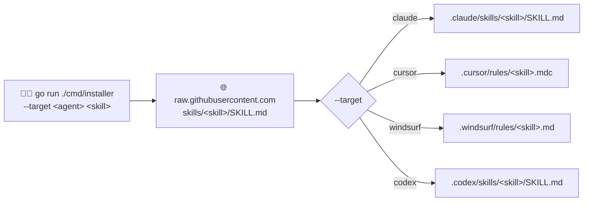
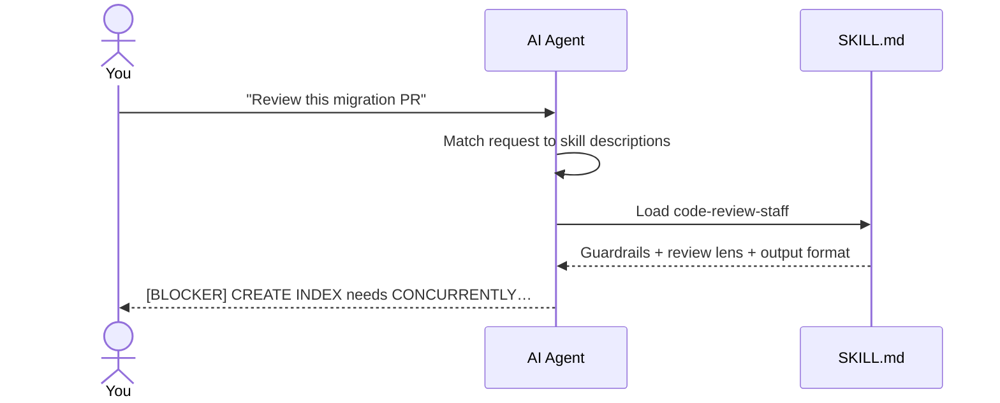
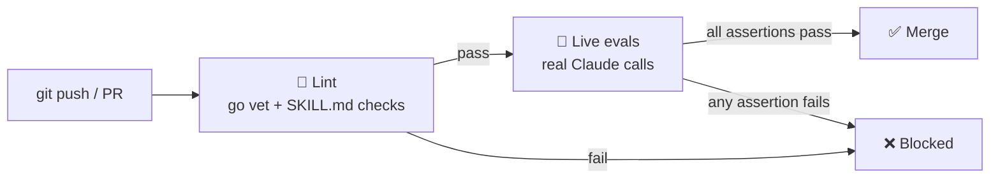
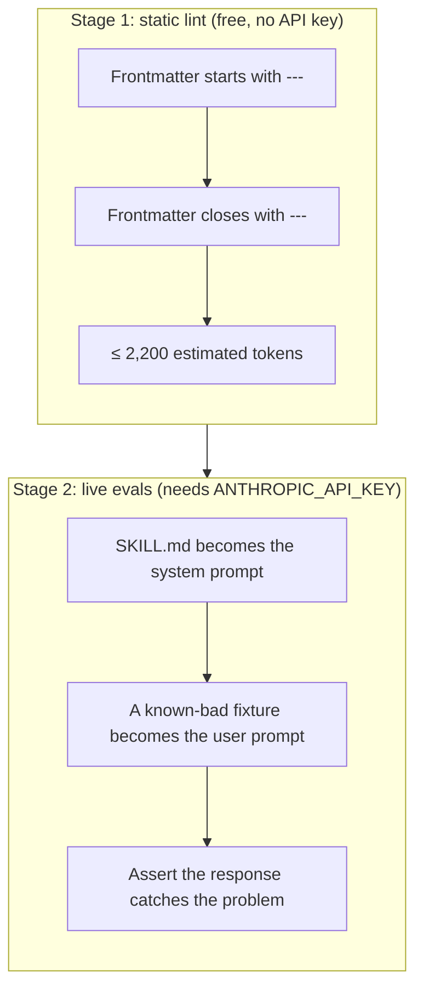

<div align="center">

# 🛠️ platform-engineering-skills

**Opinionated, eval-tested AI agent skills for Staff Engineers, SREs, and Platform teams.**

[](https://github.com/drarnold/platform-engineering-skills/actions/workflows/evals.yml)


[](LICENSE)

Works with **Claude Code** · **Cursor** · **Windsurf** · **OpenAI Codex CLI**

[Quick Start](#-quick-start) · [How It Works](#-how-it-works) · [Skills](#-the-skills) · [Eval Pipeline](#-the-eval-pipeline) · [Contributing](#-adding-a-skill)

</div>

---

## 💡 Why This Exists

Most AI coding setups fall apart in production because agents:

| Failure mode | What it looks like |
|---|---|
| 🎯 **Optimize for clever code over blast radius** | Missing table locks, retry storms, broken rolling deploys |
| ⚡ **Mutate state too eagerly** | Running destructive commands before confirming evidence |
| 🌊 **Drift silently over time** | A prompt tweak breaks an edge case and nobody notices |

This repo treats agent workflows like real platform infrastructure: **tightly scoped context**, **explicit guardrails**, **predictable output formats**, and **automated lint + LLM evals**.

Every skill is a focused `SKILL.md` module, installed by a small **Go** CLI and regression-tested in CI.

---

## 🚀 Quick Start

```bash
# Install every skill for Claude Code  →  .claude/skills/
go run ./cmd/installer --target claude --all

# Install one skill for Cursor         →  .cursor/rules/
go run ./cmd/installer --target cursor incident-triage
```

### Where each agent gets its skills

| `--target` | Installs to | Format |
|---|---|---|
| `claude` | `.claude/skills/<skill>/SKILL.md` | folder + `SKILL.md` |
| `cursor` | `.cursor/rules/<skill>.mdc` | single `.mdc` file |
| `windsurf` | `.windsurf/rules/<skill>.md` | single `.md` file |
| `codex` | `.codex/skills/<skill>/SKILL.md` | folder + `SKILL.md` |

Run it from the root of the project you want the skills in.

---

## ⚙️ How It Works

### 1. Install: one `SKILL.md`, four agents

The installer downloads the skill from this repo and drops it where your agent already looks for instructions.



### 2. Run: the agent loads the right skill for the job

Each skill has a one-line `description` in its frontmatter. The agent reads those, picks the matching skill, and follows its guardrails and output format.



### 3. Trust: every change is linted and tested in CI



Details in [The Eval Pipeline](#-the-eval-pipeline).

---

## 🧰 The Skills

| Skill | Use it when | Guardrail focus |
|---|---|---|
| 🚨 [`incident-triage`](skills/incident-triage/SKILL.md) | A service is degraded, or you're writing the post-mortem | Restore service and contain blast radius before refactoring; confirm evidence before mutating state |
| 🏛️ [`architecture-rfc`](skills/architecture-rfc/SKILL.md) | Drafting or reviewing a design doc or ADR | Trade-offs, failure modes, tail latency, cost predictability |
| 🔒 [`ci-cd-hardening`](skills/ci-cd-hardening/SKILL.md) | Auditing Dockerfiles, GitHub Actions, CI/CD pipelines | Supply chain, script injection, unpinned actions, build performance |
| 📈 [`observability-slos`](skills/observability-slos/SKILL.md) | Designing telemetry and alerting | OpenTelemetry, Prometheus rules, multi-window burn-rate SLOs over noisy cause-based alerts |
| 🔍 [`code-review-staff`](skills/code-review-staff/SKILL.md) | Reviewing a diff, schema change, or PR | Zero-downtime migrations, concurrency hazards, API compatibility; no nitpicks |

---

## 🧪 The Eval Pipeline

Skills are code, so they get tests. The harness in [`cmd/evals`](cmd/evals/main.go) runs two stages.



### What the live evals assert

Each eval feeds a deliberately broken fixture to the model with the skill loaded, then checks the response.

| Skill | Fixture | The model must… |
|---|---|---|
| `code-review-staff` | [`bad_migration.sql`](evals/fixtures/bad_migration.sql) | flag it as `[BLOCKER]`, call out `CONCURRENTLY` for the index, and identify the lock/default risk |
| `ci-cd-hardening` | [`insecure_workflow.yml`](evals/fixtures/insecure_workflow.yml) | flag it as `[CRITICAL]`, catch script injection, and call for SHA-pinned actions |

> **Coverage today:** all 5 skills pass the lint stage; live evals cover `code-review-staff` and `ci-cd-hardening`. The other three are next.

### Run it locally

```bash
# Lint only: fast, free, no key needed
go run ./cmd/evals --lint-only

# Full run: lint + live model evals
ANTHROPIC_API_KEY=sk-ant-... go run ./cmd/evals
```

In GitHub Actions the lint job gates the live-eval job. Live evals are skipped on fork PRs, where secrets aren't available.

---

## ➕ Adding a Skill

1. Create `skills/<name>/SKILL.md` with YAML frontmatter:
   ```markdown
   ---
   name: my-skill
   description: One sentence on what it does and when to use it.
   ---
   ```
2. Keep it under **2,200 estimated tokens**. Lint enforces this.
3. Add the name to `allSkills` in [`cmd/installer/main.go`](cmd/installer/main.go).
4. Ideally add a fixture in `evals/fixtures/` and an eval in [`cmd/evals/main.go`](cmd/evals/main.go) that proves the skill catches what it should.
5. Run `go run ./cmd/evals --lint-only`, then open a PR.

---

## 📁 Repo Layout

```text
.
├── skills/                 # One folder per skill, each with a SKILL.md
├── cmd/
│   ├── installer/          # Installs skills into Claude / Cursor / Windsurf / Codex
│   └── evals/              # Lint + live LLM eval harness
├── evals/fixtures/         # Known-bad inputs the evals feed to the model
└── .github/workflows/      # CI: lint → live evals
```

---

<div align="center">

Released under the [LICENSE](LICENSE). Built for people who get paged.

</div>
